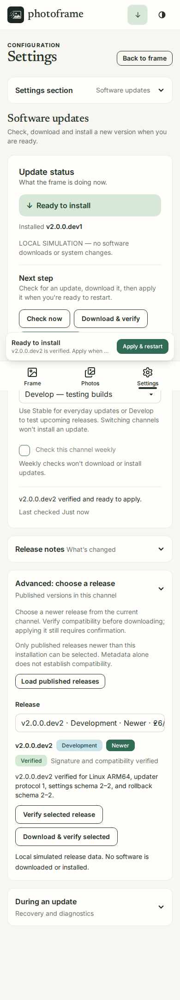
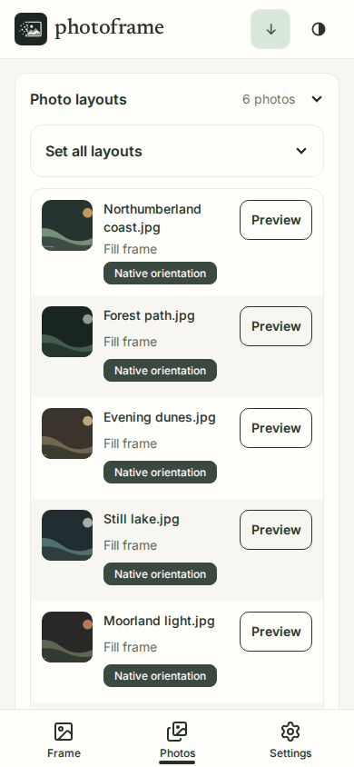
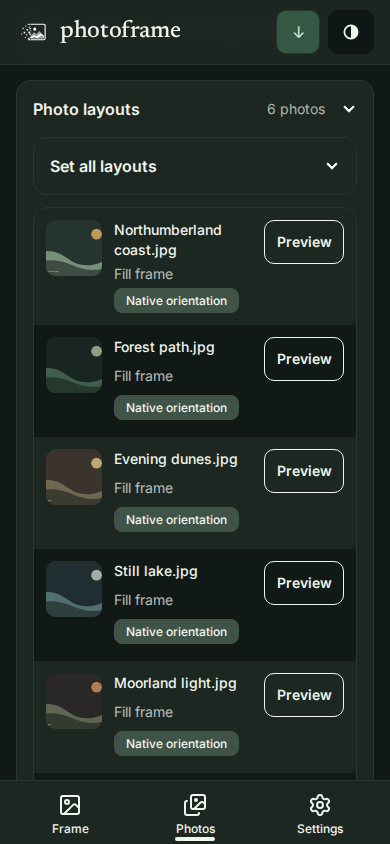
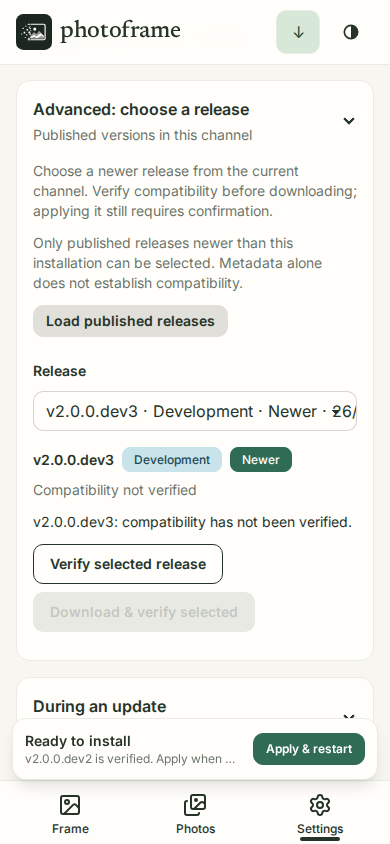
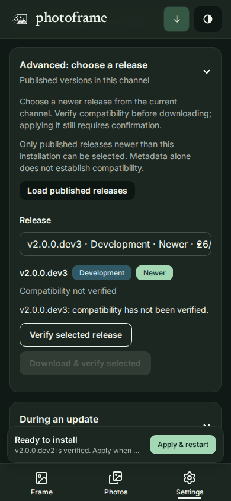

# Photoframe v2 design system

Photoframe uses a quiet gallery style: photos lead, controls remain clear, and progress is visible without turning every screen into a dashboard. This document defines the shared language for the FastAPI, HTMX, Tailwind and daisyUI interface.

## Themes and colour

Use `data-theme="photoframe-light"` or `data-theme="photoframe-dark"` on the root element. The existing stored preference remains `light` or `dark`; map it to the corresponding theme name. The light theme is the default when there is no saved choice. Theme colours live only in [the CSS source](../assets/styles/v2.css), as daisyUI semantic tokens; use `bg-base-100`, `text-base-content`, `btn-primary` and similar classes instead of page-specific hex colours.

| Role | Light | Dark | Meaning |
| --- | --- | --- | --- |
| Base 100 | `#fffefa` | `#1c2721` | Cards, dialogs, raised controls |
| Base 200 | `#f7f6f0` | `#111916` | Page canvas and soft surfaces |
| Base 300 | `#e9ece4` | `#29362d` | Dividers and borders |
| Base content | `#263329` | `#eff4ec` | Main text |
| Primary | `#2f6b55` | `#a4d7b4` | Main action, active navigation, focus |
| Secondary | `#665d48` | `#cfc3a8` | Supporting action or emphasis |
| Accent | `#d8e8d8` | `#355844` | Gentle selection and gallery highlights |
| Info | `#c8e3e9` | `#315965` | Neutral status and guidance |
| Success | `#d4ead6` | `#315c3e` | Completed and saved |
| Warning | `#f1ddb5` | `#644c2c` | Needs attention; work can continue |
| Error | `#f1d3ce` | `#653b38` | Failed action or destructive control |

Each semantic background has its own `*-content` colour in both themes. Never convey a status by colour alone: pair the colour with a label or message.

## App icon

The approved mark is a photograph being inked into existence: a mountain landscape and sun inside a frame whose left edge dissolves into square pixels. The supplied [editable SVG](../src/photoframe/static/photoframe.svg) is the canonical artwork; its composition is preserved. `--icon-bg` uses the dark theme's base-100 spruce, `--icon-ink` uses the light theme's base-100 warm paper, and `--icon-mid` is a 55% paper / 45% spruce mix. The same high-contrast tile appears in both themes, while the browser's theme colour follows the selected theme.

After `npm ci`, run `uv run python scripts/build_app_icons.py` to read the theme tokens and regenerate the icon family directly from the SVG. The pinned resvg renderer is development tooling only; the installed app serves static assets. Do not redraw the mark in the generator. Only the tiny favicons simplify subpixel fragments and thicken the frame. The Apple touch icon has an opaque background; the maskable Android icon keeps the complete mark inside the safe circle.

| Surface | Asset |
| --- | --- |
| Primary app logo | `photoframe.svg` |
| Browser tab | `favicon.svg`, 16/32/48px PNGs, and multi-size `favicon.ico` |
| iOS home screen | Opaque 180px `apple-touch-icon.png` |
| Android / installable web app | `icon-192.png`, `icon-512.png`, and `icon-maskable-512.png` |

Both app and showcase use `components/branding.html` for their metadata. The `inked` asset revision refreshes previously cached icons. The [branding size sheet](images/ui-v2-branding.png) shows the generated mark at app, header, and actual favicon sizes on both theme backgrounds.

## Visual reference

These full-page captures show the live `/ui/showcase` route at desktop (1365px) and mobile (390px). The page renders the same shared Jinja components used throughout the app. Open an image for full resolution.

| Light | Dark |
| --- | --- |
|  |  |
|  |  |

The integrated mobile screens below use demo data at 390px. The Frame capture shows the primary navigation without a permanent activity tray. Photos provides direct framing actions and a photo-layout table. Software updates is a Settings section; its controls wrap within the viewport.

| Frame | Photos | Updates |
| --- | --- | --- |
|  |  |  |

## Typography and rhythm

Inter Variable is the application face: controls, navigation, cards, dialogs, body copy and status.
Newsreader Variable is reserved for editorial page/section titles and the wordmark. Both are
self-hosted variable fonts; never introduce a second control face, browser-default serif heading,
or an arbitrary font weight on an individual screen. Diagnostics may use the inherited system
monospace stack only when presenting literal code.

| Role | Shared utility | Font, size / line height | Weight | Usage |
| --- | --- | --- | --- | --- |
| Page title | `pf-display-title` | Newsreader, 32–48px / 1.08 | 500 | One page title, album title |
| Section title | `pf-section-title` | Newsreader, 24–32px / 1.15 | 500 | Major page sections and wordmark |
| Card/dialog title | `pf-card-title` | Inter, 18px / 24px | 600 | Cards, photo preview and confirmation dialogs |
| Subheading | `pf-subheading` | Inter, 16px / 24px | 600 | Disclosures, operational status and groups inside cards |
| Body | `pf-body` or inherited body | Inter, 16px / 24px | 400 | Reading copy and card body defaults |
| Supporting/help | `pf-help` | Inter, 14px / 20px | 400 | Descriptions, help and validation text |
| Field label | `pf-label` | Inter, 14px / 20px | 600 | Associated input/select labels and radio choices |
| Button | `pf-control` | Inter, 14px / 20px | 600 | All action sizes; size variants change dimensions, not the type role |
| Input/select value | shared form controls | Inter, 16px | 400 | Readable entry values; avoids iOS focus zoom |
| Metadata | `pf-metadata` | Inter, 12px / 16px | 500 | Badges, dock labels and short supplementary values |
| Eyebrow | `pf-eyebrow` | Inter, 12px / 18px, uppercase | 700 | Sparse short section labels only |

Use `pf-supporting` for secondary text colour, `pf-measure` for a 70ch reading width and
`pf-tabular` for numbers that update in place. Normal emphasis uses 600; 700 is reserved for
eyebrows. Keep link text in its surrounding type role. Do not shrink field labels or help to
daisyUI's 12px fieldset default; the shared macros apply explicit roles. Do not add display-serif
styling to controls or confirmation dialogs.

Spacing follows Tailwind's 4px unit. Default gaps are 8px within a control, 12px between close elements, 16px within cards and 24–32px between sections. daisyUI selector radius is 8px, field radius 10px and card/dialog radius 14px. Surfaces use a one pixel border and minimal elevation. Do not add one-off shadows or arbitrary radii to individual pages.

Fonts are copied from the OFL-licensed `@fontsource-variable/inter` and `@fontsource-variable/newsreader` packages. Only the necessary unicode subsets load. Run `npm run build:css` to copy font files and compile Tailwind; the app serves the checked-in `static/v2.css` and local `static/fonts` files, with no Node or CDN at runtime. License copies ship alongside the fonts.

### Navigation icon family

Frame uses Lucide **image**, Photos uses **images**, and Settings uses the conventional
**settings** gear. The shared icon macro vendors those [official SVG paths](https://github.com/lucide-icons/lucide/tree/main/icons)
with round caps/joins and a 2-unit stroke on a 24-unit canvas. The mobile dock renders 24px icons;
the desktop sidebar renders the same family at 20px. Icons inherit text colour, stay decorative
beside visible labels, and do not require a runtime icon library or network access.

Dock labels use `pf-metadata`, with a 4px icon/label gap, at least 48px touch targets and space
for the active marker. The dock retains bottom safe-area padding. Do not replace one destination
with a differently weighted icon family. The vendored
[Lucide license](../src/photoframe/static/vendor/lucide-LICENSE.txt) ships with the app.

## Shared components

Use the Jinja macros in `src/photoframe/templates/components/` as the canonical API. Their Daisy classes and variants are deliberate. Add a variant there when a product need recurs; avoid local copies of the same control.

| Component | Shared macro | Canonical variants and use |
| --- | --- | --- |
| Button | `actions.button` | Primary for the next main action; secondary (`btn-outline`) for alternatives; quiet (`btn-ghost`) for low priority; danger (`btn-error`) for destructive actions; success only for a meaningful completed action. `sm`, `md`, `lg` sizes. Loading combines spinner and `aria-busy`; disabled disables interaction. |
| Link | `actions.link` | Text link (`link-primary`) inside copy; button styles only for action-like navigation. Active navigation uses `aria-current`. |
| Form fields | `forms.input_field`, `select_field`, `checkbox_field`, `radio_card` | `fieldset`, visible label and associated help. Labels and help wrap within narrow viewports. `input-error` / `select-error` plus `aria-invalid` for failed validation. Explain the correction in text. |
| Card | `surfaces.card` | Default (`base-100`), soft (`base-200`), emphasis (`primary`). Keep a consistent `card-body` and border. |
| Disclosure | `surfaces.disclosure` | Native `details` with `collapse-arrow`; short title and optional current-value summary. `advanced` uses the same neutral surface and border, with an explicit Advanced title. Expertise is not a status; reserve semantic colours for availability, channel, verification, warnings and errors. Use for advanced or less frequent settings. |
| Empty state | `surfaces.empty_state` | Name the missing content, explain one next step and offer one action when possible. |
| Badge | `feedback.badge` | Distinguish Native orientation, Default framing, Custom framing and Unavailable. Hidden is separate. Orientation alone never implies an error or blocks rotation. |
| Alert | `feedback.alert` | Info/success status; warning/error alert. Keep text actionable, persistent while relevant and understandable without colour. |
| Progress | `feedback.progress_bar`, `feedback.steps`, `feedback.loading` | Determinate progress uses `progress`; multi-stage operations use `steps` with current step marked; indeterminate waiting uses `loading-spinner` with visible text. |
| Table | `data.table` | Semantic caption, column headers, row headers and restrained `table-zebra`. Use `stacked=true` for photo records: one set of semantic rows becomes labelled compact records below 768px, without horizontal scrolling. |
| Dialog | `dialogs.dialog` | Native `dialog` with `modal` styling. Give a specific title, consequence text and an explicit danger action when destructive. Return focus to the trigger after close. |
| Mobile navigation | `navigation.mobile_dock` | Frame, Photos and Settings, with Updates inside Settings. Keep it visible until the desktop sidebar appears. Active items have labels and `aria-current`. |

The component showcase renders these same macros in both themes. It must be maintained as components change; the repository screenshots provide a reviewable reference without a running browser.

Software updates keeps the release history in an Advanced disclosure. Loading the list does not
download or install software. A chosen release is inspected for compatibility before the separate
download action, and Apply still requires confirmation. Older updater helpers explain their
latest-release-only capability; the web app does not silently replace a privileged service.

## Interaction rules

- Keep the primary destination and current state visible on mobile. The page header and bottom navigation can remain fixed; only the content area scrolls. Respect safe-area insets and leave enough bottom padding for the dock.
- During a multi-step update, put the current step, concise progress and next available action together near the top or in a compact sticky status area. Avoid forcing a return trip through a long log. Keep detail logs in a disclosure.
- Do not show a permanent floating Next photo action. Reserve the contextual tray for active operations and actionable update steps.
- Open photo previews and framing in a shared dialog with focus returned to the trigger. Never force a long scroll to reach the editor. Let the photo-layout table apply the default to the album in one atomic operation; explain when this replaces custom framing.
- Settings opens configuration directly. Its current section appears in a compact disclosure on mobile, opening a vertical link list; desktop uses a vertical sidebar. Every section has the same title and description hierarchy. Form controls wrap; page-level horizontal scrolling is never needed.
- Use HTMX to replace the smallest meaningful status or content region. Announce important changed state through a live region; preserve focus and do not replace the control that currently has focus without deliberate handling.
- At 320px width, actions must remain reachable and labels readable. Use an in-card vertical stack rather than squeezed side-by-side buttons. Keep dialogs within the viewport and let their content scroll.
- Every icon-only action needs a text alternative. Interactive targets should be about 44px high on touch screens. The shared focus ring is visible in both themes. Reduced-motion users receive near-instant transitions.

## Review checklist

Review each screen in light and dark, desktop and 320–390px mobile. Check keyboard order and dialog focus, loading/empty/error/success states, long names, tables, and browser zoom. Compare new patterns to the showcase and shared macros before adding a new variant.

Release selection keeps a native picker with textual status labels. Its selected-release summary
pairs Development (Info) or Stable (Success) with a separate Newer (Primary), Installed or Older
(Neutral) badge. Unavailable is Warning. These labels describe release metadata, never compatibility;
only a successful signature and compatibility inspection earns a Verified label. Badge text wraps
inside an automatically sized pill in both themes.

Mobile photo records use the shared `data.photo_layout_record` macro: a fixed 56px cached
thumbnail, flexible filename/layout text, and a fixed 80px action track. Status spans beneath the
text/action tracks so wrapping labels cannot displace the action. Desktop uses a 40px thumbnail
beside the filename. Keep touch actions at least 44px; visually clamp filenames to two lines
while retaining the full name in accessible text. Missing previews reveal a local image icon. Bulk layout fields stay collapsed above the records, so opening
Photo layouts reaches the photos immediately. Do not expand explanatory copy ahead of the list.
The release picker selects the first installable newer entry after loading, without starting
verification or a download. Header update status appears on phones and desktop only for an
available/staged update, an active operation, or a failure needing attention. Phones use a 44px
icon link with the full status in its accessible label; ordinary idle status stays on Updates.

## Photo gallery

The Photos gallery uses two columns on phones and three on larger screens. Each image is a
native button that opens the existing framing dialog. Keep the caption to one line: a shared
neutral fit badge and a flexible, ellipsized filename. Full filenames and framing details stay
available through the button's accessible name and tooltip. Do not add a separate framing action
under each image.

Use the shared info badge over the image for **On frame now**. This represents the last completed
display update; the selected-photo outline represents the current preview. Keep those states
distinct. Retain visible keyboard focus, meaningful thumbnail-failure text and focus restoration
after HTMX swaps. Default layouts, bulk layouts and hidden-photo recovery remain available below
the gallery.

## Mobile thumbnail records and advanced controls

The app and showcase render the same record macro. Cached thumbnails load lazily through the
existing endpoint; this view never requests full-size originals. The showcase uses a tiny copy of
the app’s own generated demo art, so it remains usable offline.

| Light | Dark |
| --- | --- |
|  |  |
|  |  |

Manual release selection and other advanced disclosures use neutral base surfaces. The literal
Advanced label explains the control’s purpose. Reserve colour for a release’s channel, age,
verified compatibility, or an actual warning/error; advanced settings alone are not a warning.
