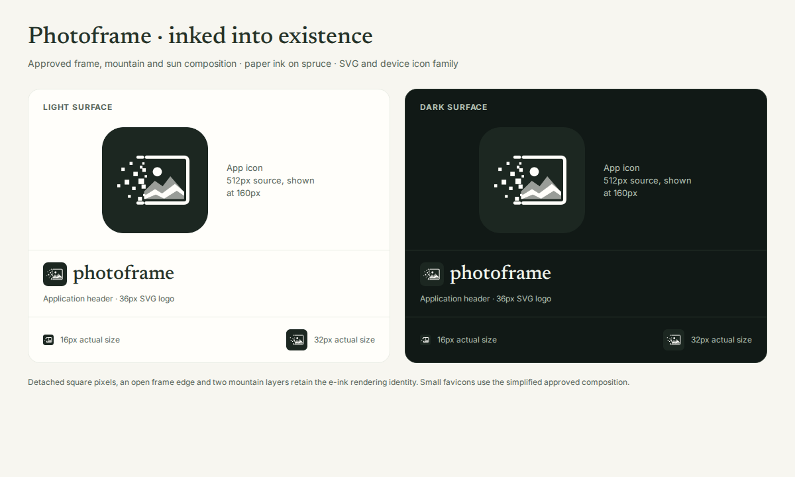
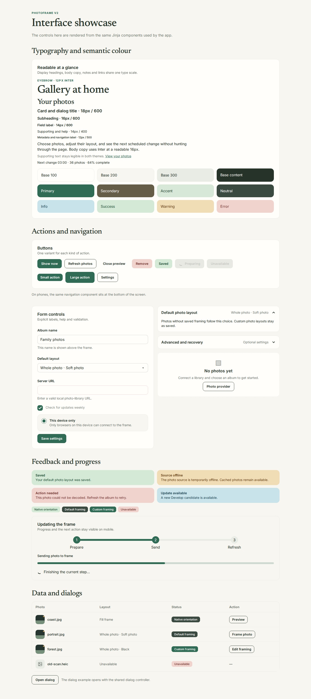
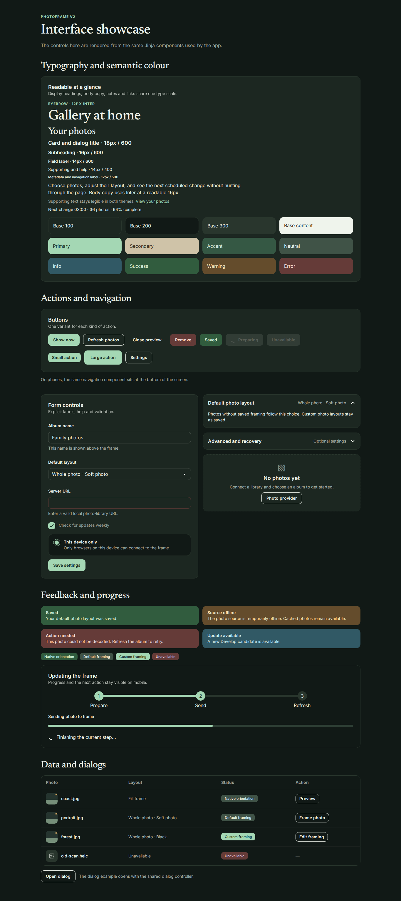
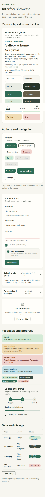
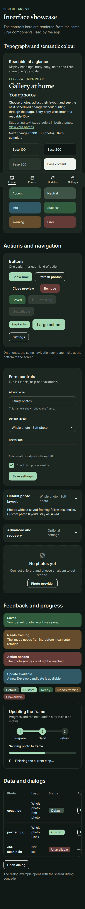
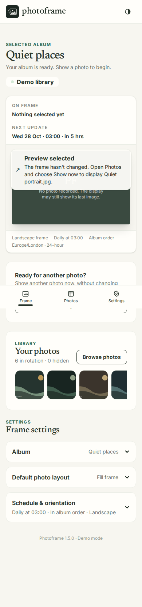
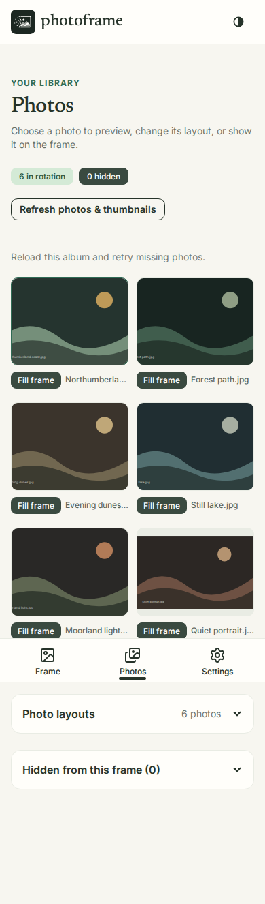
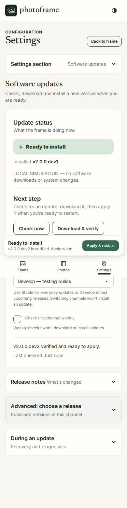
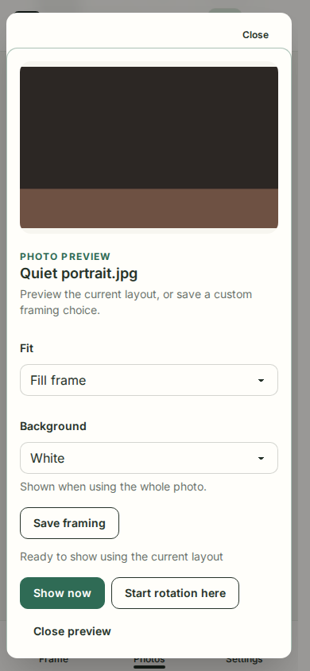

# Photoframe v2 design system

Photoframe uses a quiet gallery style: photos lead, controls remain clear, and progress is visible without turning every screen into a dashboard. This document defines the shared language for the FastAPI, HTMX, Tailwind and daisyUI interface.

## Themes and colour

Use `data-theme="photoframe-light"` or `data-theme="photoframe-dark"` on the root element. The existing stored preference remains `light` or `dark`; map it to the corresponding theme name. The light theme is the default when there is no saved choice. Theme colours live only in [the CSS source](../assets/styles/v2.css), as daisyUI semantic tokens; use `bg-base-100`, `text-base-content`, `btn-primary` and similar classes instead of page-specific hex colours.

| Role | Light | Dark | Meaning |
| --- | --- | --- | --- |
| Base 100 | `#fffefa` | `#1c2721` | Cards, dialogs, raised controls |
| Base 200 | `#f7f6f0` | `#111916` | Page canvas and soft surfaces |
| Base 300 | `#e9ece4` | `#29362d` | Dividers and borders |
| Base content | `#263329` | `#eff4ec` | Main text |
| Primary | `#2f6b55` | `#a4d7b4` | Main action, active navigation, focus |
| Secondary | `#665d48` | `#cfc3a8` | Supporting action or emphasis |
| Accent | `#d8e8d8` | `#355844` | Gentle selection and gallery highlights |
| Info | `#c8e3e9` | `#315965` | Neutral status and guidance |
| Success | `#d4ead6` | `#315c3e` | Completed and saved |
| Warning | `#f1ddb5` | `#644c2c` | Needs attention; work can continue |
| Error | `#f1d3ce` | `#653b38` | Failed action or destructive control |

Each semantic background has its own `*-content` colour in both themes. Never convey a status by colour alone: pair the colour with a label or message.

## App icon

The approved mark is a photograph being inked into existence: a mountain landscape and sun inside a frame whose left edge dissolves into square pixels. The supplied [editable SVG](../src/photoframe/static/photoframe.svg) is the canonical artwork; its composition is preserved. `--icon-bg` uses the dark theme's base-100 spruce, `--icon-ink` uses the light theme's base-100 warm paper, and `--icon-mid` is a 55% paper / 45% spruce mix. The same high-contrast tile appears in both themes, while the browser's theme colour follows the selected theme.

After `npm ci`, run `uv run python scripts/build_app_icons.py` to read the theme tokens and regenerate the icon family directly from the SVG. The pinned resvg renderer is development tooling only; the installed app serves static assets. Do not redraw the mark in the generator. Only the tiny favicons simplify subpixel fragments and thicken the frame. The Apple touch icon has an opaque background; the maskable Android icon keeps the complete mark inside the safe circle.

| Surface | Asset |
| --- | --- |
| Primary app logo | `photoframe.svg` |
| Browser tab | `favicon.svg`, 16/32/48px PNGs, and multi-size `favicon.ico` |
| iOS home screen | Opaque 180px `apple-touch-icon.png` |
| Android / installable web app | `icon-192.png`, `icon-512.png`, and `icon-maskable-512.png` |

Both app and showcase use `components/branding.html` for their metadata. The `inked` asset revision refreshes previously cached icons. The [branding size sheet](images/ui-v2-branding.png) shows the generated mark at app, header, and actual favicon sizes on both theme backgrounds.

## Visual reference

These full-page captures show the live `/ui/showcase` route at desktop (1365px) and mobile (390px). The page renders the same shared Jinja components used throughout the app. Open an image for full resolution.

| Light | Dark |
| --- | --- |
|  |  |
|  |  |

The integrated mobile screens below use demo data at 390px. The Frame capture shows the primary navigation without a permanent activity tray. Photos provides direct framing actions and a photo-layout table. Software updates is a Settings section; its controls wrap within the viewport.

| Frame | Photos | Updates |
| --- | --- | --- |
|  |  |  |

## Typography and rhythm

Inter Variable is the body and control face. Newsreader Variable is the display face for the page title, section headings and editorial photo captions. Use `.pf-display-title` for the main title and `.pf-section-title` for section titles. Use `.pf-eyebrow` sparingly for short uppercase labels; `.pf-supporting` for secondary copy; `.pf-tabular` for numbers that update in place. Keep body copy at 16px, controls at 14–16px, and reserve 12px for short metadata. Text columns use `.pf-measure` (70ch maximum).

Spacing follows Tailwind's 4px unit. Default gaps are 8px within a control, 12px between close elements, 16px within cards and 24–32px between sections. daisyUI selector radius is 8px, field radius 10px and card/dialog radius 14px. Surfaces use a one pixel border and minimal elevation. Do not add one-off shadows or arbitrary radii to individual pages.

Fonts are copied from the OFL-licensed `@fontsource-variable/inter` and `@fontsource-variable/newsreader` packages. Only the necessary unicode subsets load. Run `npm run build:css` to copy font files and compile Tailwind; the app serves the checked-in `static/v2.css` and local `static/fonts` files, with no Node or CDN at runtime. License copies ship alongside the fonts.

## Shared components

Use the Jinja macros in `src/photoframe/templates/components/` as the canonical API. Their Daisy classes and variants are deliberate. Add a variant there when a product need recurs; avoid local copies of the same control.

| Component | Shared macro | Canonical variants and use |
| --- | --- | --- |
| Button | `actions.button` | Primary for the next main action; secondary (`btn-outline`) for alternatives; quiet (`btn-ghost`) for low priority; danger (`btn-error`) for destructive actions; success only for a meaningful completed action. `sm`, `md`, `lg` sizes. Loading combines spinner and `aria-busy`; disabled disables interaction. |
| Link | `actions.link` | Text link (`link-primary`) inside copy; button styles only for action-like navigation. Active navigation uses `aria-current`. |
| Form fields | `forms.input_field`, `select_field`, `checkbox_field`, `radio_card` | `fieldset`, visible label and associated help. Labels and help wrap within narrow viewports. `input-error` / `select-error` plus `aria-invalid` for failed validation. Explain the correction in text. |
| Card | `surfaces.card` | Default (`base-100`), soft (`base-200`), emphasis (`primary`). Keep a consistent `card-body` and border. |
| Disclosure | `surfaces.disclosure` | Native `details` with `collapse-arrow`; short title and optional current-value summary. Use for advanced or less frequent settings. |
| Empty state | `surfaces.empty_state` | Name the missing content, explain one next step and offer one action when possible. |
| Badge | `feedback.badge` | Distinguish Native orientation, Default framing, Custom framing and Unavailable. Hidden is separate. Orientation alone never implies an error or blocks rotation. |
| Alert | `feedback.alert` | Info/success status; warning/error alert. Keep text actionable, persistent while relevant and understandable without colour. |
| Progress | `feedback.progress_bar`, `feedback.steps`, `feedback.loading` | Determinate progress uses `progress`; multi-stage operations use `steps` with current step marked; indeterminate waiting uses `loading-spinner` with visible text. |
| Table | `data.table` | Semantic caption, column headers, row headers and restrained `table-zebra`. Horizontal scroll stays within the table on narrow screens. |
| Dialog | `dialogs.dialog` | Native `dialog` with `modal` styling. Give a specific title, consequence text and an explicit danger action when destructive. Return focus to the trigger after close. |
| Mobile navigation | `navigation.mobile_dock` | Frame, Photos and Settings, with Updates inside Settings. Keep it visible until the desktop sidebar appears. Active items have labels and `aria-current`. |

The component showcase renders these same macros in both themes. It must be maintained as components change; the repository screenshots provide a reviewable reference without a running browser.

## Interaction rules

- Keep the primary destination and current state visible on mobile. The page header and bottom navigation can remain fixed; only the content area scrolls. Respect safe-area insets and leave enough bottom padding for the dock.
- During a multi-step update, put the current step, concise progress and next available action together near the top or in a compact sticky status area. Avoid forcing a return trip through a long log. Keep detail logs in a disclosure.
- Do not show a permanent floating Next photo action. Reserve the contextual tray for active operations and actionable update steps.
- Open photo previews and framing in a shared dialog with focus returned to the trigger. Never force a long scroll to reach the editor. Let the photo-layout table apply the default to the album in one atomic operation; explain when this replaces custom framing.
- Settings opens configuration directly. Its section chooser and form controls wrap on mobile; page-level horizontal scrolling is never needed.
- Use HTMX to replace the smallest meaningful status or content region. Announce important changed state through a live region; preserve focus and do not replace the control that currently has focus without deliberate handling.
- At 320px width, actions must remain reachable and labels readable. Use an in-card vertical stack rather than squeezed side-by-side buttons. Keep dialogs within the viewport and let their content scroll.
- Every icon-only action needs a text alternative. Interactive targets should be about 44px high on touch screens. The shared focus ring is visible in both themes. Reduced-motion users receive near-instant transitions.

## Review checklist

Review each screen in light and dark, desktop and 320–390px mobile. Check keyboard order and dialog focus, loading/empty/error/success states, long names, tables, and browser zoom. Compare new patterns to the showcase and shared macros before adding a new variant.
